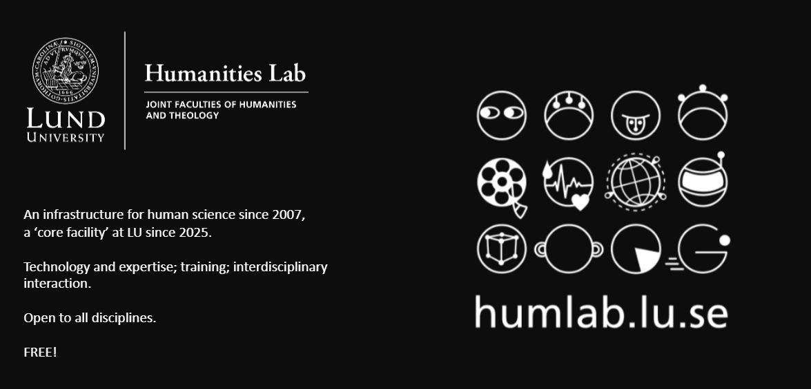
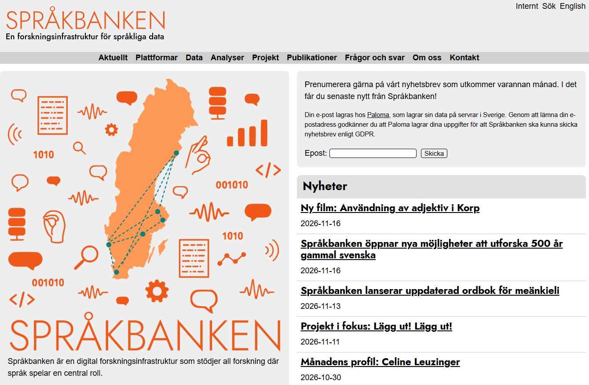
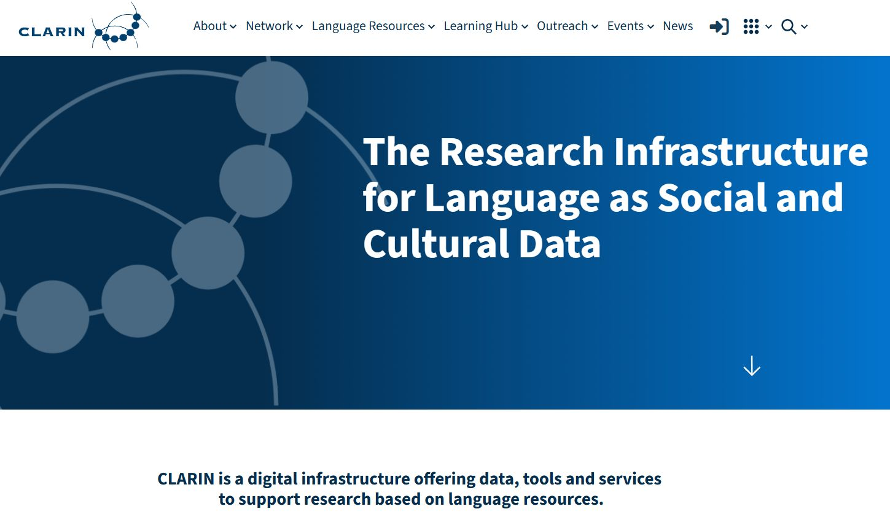

Open Science

# Open Science in Språkbanken CLARIN

From open data to open capabilities

    

- Language resources are essential for linguistics and language technology.
- Open Science asks us to make research outputs reusable.
- Some of our most valuable resources cannot simply be made open.

> How can Språkbanken CLARIN make these resources useful for Open Science?

  

**Speaker notes**

Open Science and data protection are sometimes presented as opposing forces. Research infrastructure can reconcile them.

---

## Why am I here?

    

### Local

**[Lund University Humanities Lab](https://humlab.lu.se)**

A local home for language data and research expertise.

### National

**[Språkbanken CLARIN](https://sprakbanken.se)**

A Swedish network for language research infrastructure.

### European

**[CLARIN ERIC](https://clarin.eu)**

A European infrastructure for discovering and reusing language resources.

  

From Lund, through Språkbanken CLARIN, we work on a shared Open Science question: how can researchers discover, access and reuse language data responsibly?

**Speaker notes**

I’m speaking from the Lund University Humanities Lab, a node in the Swedish Språkbanken CLARIN consortium. Through CLARIN ERIC, the national infrastructure belongs to a wider European network. Those three levels shape how we make language data available for research.

---

## The difficult case of human language data

    

Speech, gesture and sign-language recordings can contain:

- Voices, faces and bodies
- Linguistic and demographic information
- Interaction between identifiable people
- Potentially sensitive personal information

    

> The features that make the data scientifically valuable may also make people identifiable.

Anonymising a questionnaire can preserve much of its research value. Removing a face from a sign-language video or transforming a voice can erase the very features researchers want to study.

---

## Open Science goes beyond downloads

    

> As open as possible, as closed as necessary.

      

FAIR ≠ Open

A resource can be findable, documented, interoperable and scientifically reusable while access to the original recordings is controlled.

  

**Speaker notes**

The objective is maximum legitimate scientific reuse. Public distribution is one way to support it.

---

## Språkbanken CLARIN as trusted infrastructure

    

1. Participants and collections
2. **Språkbanken CLARIN** · Trusted infrastructure
3. Researchers, language technology and new knowledge

      

A national network of nodes helps researchers at Swedish universities and institutes contribute language data and find local expertise. Shared infrastructure supports consent, licensing, preservation and access.

- Persistent metadata and documentation
- Authentication and authorization
- Standardized access levels
- Consent and data-use conditions
- Controlled environments
- Long-term governance

---

Lund University Humanities Lab Archive

## Find the resource openly. Request access when needed.

    

The Humanities Lab, a node in Språkbanken CLARIN, provides secure, long-term storage for structured language data.

Public metadata make collections discoverable across Europe through CLARIN’s Virtual Language Observatory (VLO).

    

1. **Discover** · Browse and search public metadata.
2. **Request** · Apply for access to restricted data. Requests are assessed case by case.
3. **Cite** · Use the persistent identifier assigned to each deposited resource.

  

**Speaker notes**

The archive provides CMDI metadata to the VLO and serves as a CLARIN Metadata Providing Centre (C-centre). Deposits receive persistent identifiers in the form of handles. The archive shows how a national node can support local collections and European discovery through CLARIN ERIC. KBLab illustrates a complementary route to reuse through computation.

---

## A Swedish example from KBLab

    

Språkbanken CLARIN aims to help memory institutions make cultural heritage collections findable, sustainably accessible and usable for research and AI. KBLab offers a complementary example from the National Library, where copyright and other restrictions limit distribution of some holdings.

KBLab shows how computation on these collections can produce Swedish language models, speech technology and derived resources for wider research use.

    

1. Restricted collections
2. Computation
3. Models and derived resources
4. **Wider research use**

  

**Speaker notes**

What can we responsibly make open from the dataset?

---

## Why Swedish data matter for Swedish models

Does Swedish pretraining improve performance on the same fine-tuning task?

  

      

**Generic multilingual model**

Fine-tuned on the same task

**Result X** · Pending

    

**Model pretrained on Swedish data**

Fine-tuned on the same task

**Result Y** · Pending

  

A model trained on otherwise inaccessible Swedish material may itself become a reusable scientific resource.

**Speaker notes**

Use the experiment to discuss how pretraining data affect downstream performance on this specific task. Connect it to Språkbanken CLARIN’s goal of combining high-quality data with transparent, reproducible, findable and citable Swedish language models, including specialized research models. Maintaining national capacity to develop and sustain these models supports Swedish language model sovereignty.

---

## From open data to open capabilities

    

1. **Open the data** when possible
2. **Open derived data** · Annotations, statistics and safe representations
3. **Open models** · Where permissible
4. **Provide services or APIs**
5. **Bring computation to the data** · Secure processing environments

      

> Keep metadata, documentation and provenance open at every step.

If one option is unavailable, move down to the next.

  

**Speaker notes**

If we cannot make the recording open, what is the next-most-open scientifically useful object?

---

## Access to speech and sign-language resources

    

| Resource | Possible access |
| --- | --- |
| Metadata and documentation | Open |
| Annotation schemas and tools | Open |
| Safe derived statistics | Open |
| Models | Open where risk permits |
| Transcripts | Open or controlled |
| Speech recordings | Controlled |
| Sign-language video | Controlled or secure |
| Highly sensitive audiovisual data | Compute-to-data |

      

> Models trained on restricted data can still reveal personal information.

Assess privacy and disclosure risks in model outputs, particularly for voices, faces, speaker embeddings and generative models.

Giving sign language a central place in the infrastructure means preserving the visual features researchers need to study.

---

## What could Språkbanken CLARIN provide?

1. **Common access levels** · For personal and otherwise restricted language resources.
2. **Reusable consent and data-use frameworks** · Covering language technology and machine learning.
3. **Trusted processing environments** · For data that must stay within the infrastructure.
4. **A framework for publishing derived artefacts** · Assess disclosure risks in models, statistics, annotations and services.

These ambitions build on CLARIN’s work with FAIR resources, metadata and authentication and extend it to AI and multimodal language technology.

**Speaker notes**

Lund already shows how open discovery and case-by-case access can work together. What would it take to support more collections this way and extend the approach to trusted processing and publication of derived resources?

---

## Open Science goes beyond open files

> Make language resources as scientifically accessible and reusable as possible while protecting the rights of the people represented in them.

- Open data when possible.
- Open derived resources and models when appropriate.
- Bring computation to the data when necessary.
- Keep knowledge about the resource open throughout.

**Språkbanken CLARIN can provide the trusted infrastructure that makes this possible.**
